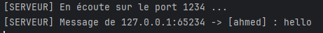
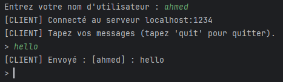
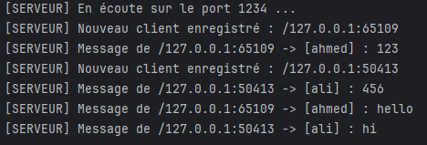
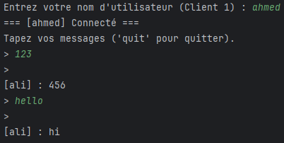
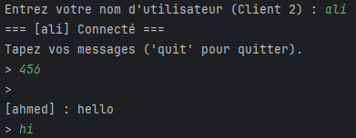

# TP 4 : Sockets en mode non-connecté UDP
Activité :  Echange des datagrammes entre C/S en mode non-connecté
            Service de chat C/S avec UDP

## Type de chat
Chat unidirectionnel (un seul client) — mode non-connecté UDP.

## Description
- Le serveur écoute sur le port `1234` via `DatagramSocket` et `InetSocketAddress`.
- Le client demande un nom d'utilisateur, lit les messages saisis et les envoie au serveur préfixés `[Nom] : message`.
- Le serveur affiche chaque message reçu avec l'adresse IP et le port de l'expéditeur.

## Test

Serveur

Client
!

## Type de chat
Chat bidirectionnel (plusieurs clients) — mode non-connecté UDP avec diffusion (broadcast).

## Description
- Le serveur conserve une liste des adresses des clients qui ont déjà envoyé un message.
- Lorsqu'un message est reçu, le serveur l'enregistre (expéditeur) puis le rediffuse à tous les autres clients enregistrés, sauf l'expéditeur.
- Le client utilise un thread de réception pour afficher les messages en temps réel tout en continuant à envoyer.

## Test

Serveur
!

Client 1
!

Client 2
!
